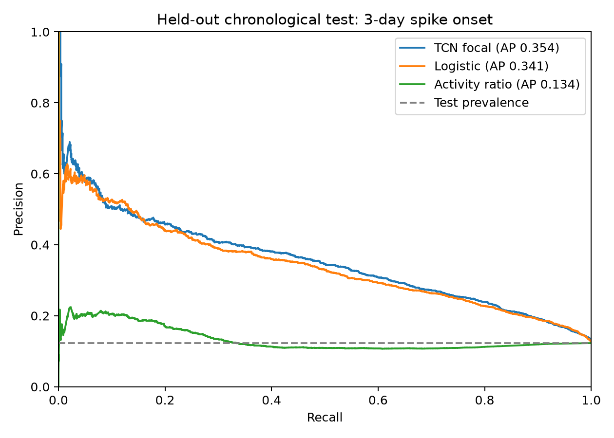

# First chronological TCN experiment

Source: GDELT daily country aggregates, 4 November 2025–3 November 2026.
The export contains 83,499 nonzero country/day rows across 259 source codes.
Training eligibility selected 243 countries/regions (GDELT/FIPS codes).
The [machine-readable report](metrics.json) is the authority for exact counts,
configuration, data hash, threshold and epoch history.

| Split | Decision dates | Samples | Positive labels |
|---|---|---:|---:|
| Train | 8 Dec 2025–16 Jun 2026 | 44,031 | 5,253 |
| Validation | 20 Jun–22 Aug 2026 | 14,835 | 1,596 |
| Test | 26 Aug–31 Oct 2026 | 15,385 | 1,892 |

Outcome windows end three days after each decision. Split boundaries purge
crossing outcome windows. Final test outcomes end 3 November 2026.

| Model | AP | Trapezoidal PR-AUC | Precision | Recall | F1 |
|---|---:|---:|---:|---:|---:|
| TCN + focal loss | .3540 | .3537 | .3543 | .4815 | .4082 |
| Balanced logistic regression | .3409 | .3405 | .3359 | .4857 | .3971 |
| Current activity ratio | .1341 | .1337 | .1230 | 1.0000 | .2190 |
| Always no spike | .1230 | See note | .0000 | .0000 | .0000 |

Test prevalence is 12.30%. The TCN threshold .551096 was selected by maximum
validation F1, not test performance. It produced 911 true positives, 1,660 false
positives, 981 false negatives and 11,833 true negatives. The model stopped after
17 epochs and restored the epoch-13 checkpoint based on validation AP.

The TCN improves AP by .0131 over logistic regression in this one held-out split.
This does not establish statistical significance or a general advantage.
The ratio baseline's validation-optimal threshold was zero (all-positive), which
explains its perfect recall and low precision. The current-spike rule is always
negative because already-spiking days are excluded from the onset task.
Constant-score trapezoidal PR-AUC interpolates a degenerate curve and is not a
useful skill comparison; its AP equals prevalence.

Labels represent news coverage changes, not independently confirmed crises.
Scores are uncalibrated. The report supports an experimental review aid;
it does not support a crisis probability or a dependable warning system.
See [pipeline definitions and reproduction steps](../../training/crisis/README.md).
